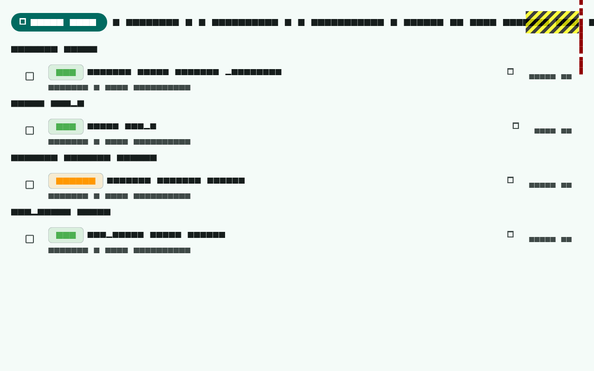
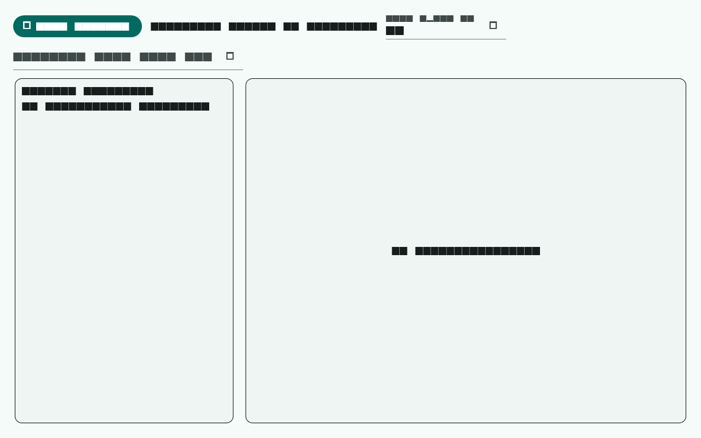
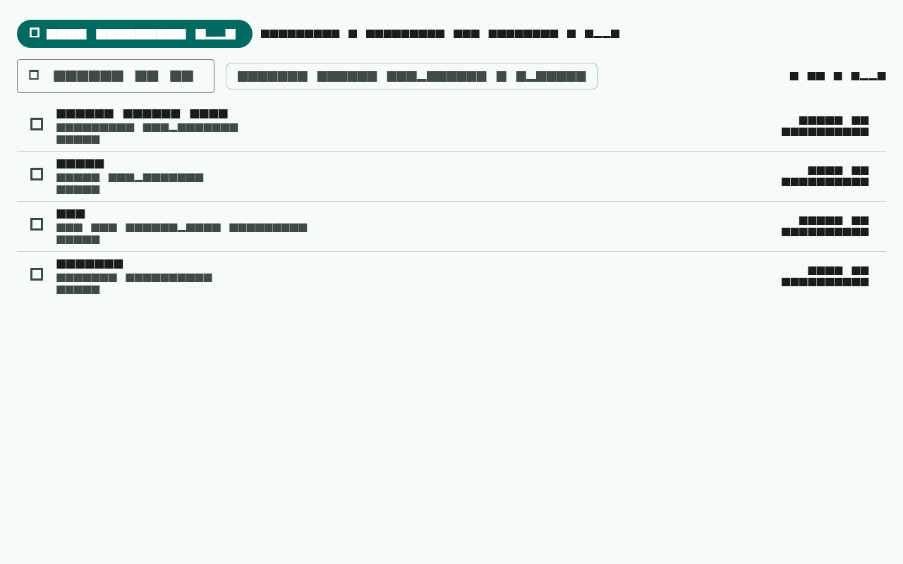
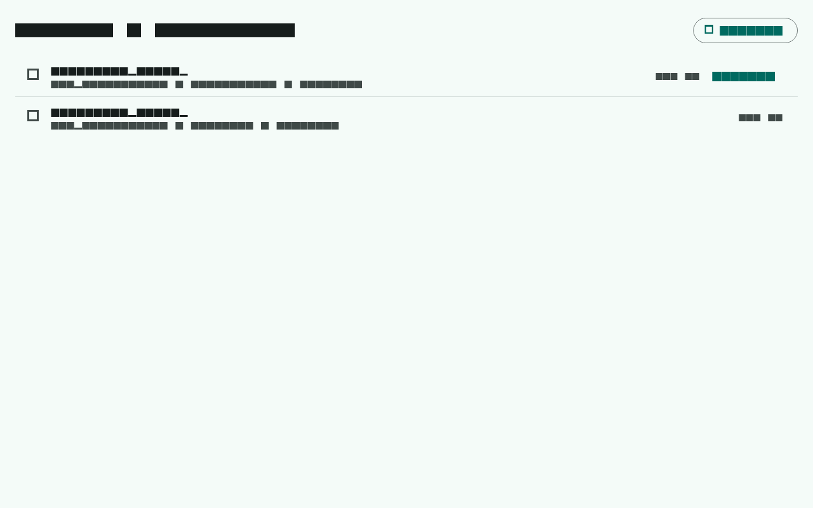

# ClearForge

Privacy-first Windows maintenance app: discover unnecessary files, quantify recoverable storage, execute reviewed cleanup safely. Flutter desktop UI + C#/.NET engine over an ACL'd named pipe.

**Status:** Active development — unified Smart Scan with journaled, restorable quarantine; duplicate keeper review; storage intelligence; app inventory + review-only leftover evidence; startup inventory with disabled-state; optional local AI. 384 .NET + 72 Flutter tests green. No permanent-delete path exists by design.

## Layout

- `apps/desktop_flutter` — Flutter Windows UI
- `native/` — .NET 8 solution (Contracts, Engine, Windows, Host, Engine.Tests)
- `config/` — versioned cleanup rules + exclusions (reviewed, never remote-loaded)
- `fixtures/` — test fixture generators
- `docs/` — architecture, threat model, cleanup policy, product definition, release checklist
- `SPEC.md` — engineering spec; `docs/product-definition.md` — canonical product brief

## Develop

```bat
rem engine
dotnet build native\ClearForge.sln
dotnet test  native\ClearForge.sln

rem UI
cd apps\desktop_flutter
flutter analyze
flutter test
flutter run -d windows   rem requires VS "Desktop development with C++" workload
```

Prereqs: .NET SDK per `global.json` (9.0.203, targets net8.0), Flutter stable with Windows desktop support, Visual Studio 2022 + "Desktop development with C++" workload to *build* the runner (analyze/test work without it).

## Screenshots

| Unified Smart Scan | Storage intelligence |
|---|---|
|  |  |
| Installed apps | Recovery history |
|  |  |

## Status & evidence

| Platform | Status |
|---|---|
| Windows x64 | **Pre-release published** — `v0.1.0-m1` on Releases (unsigned preview); **not RELEASE-READY** |
| macOS | **BLOCKED** — no verified macOS build or adapter |

Release gates tracked in `docs/release-checklist.md`. No platform is
`RELEASE-READY` or `SHIPPED` today.

Measured on the dev machine (2026-10-27), not marketing claims:

- **454 automated tests green** — 384 .NET engine tests + 70 Flutter tests; `flutter analyze` clean; CI lanes dotnet / flutter / m44-GUI all green on main.
- **Live UAT walkthrough** (`integration_test/uat_walkthrough_test.dart`): real engine → 296 registered apps inventoried, 13 startup entries, 14 browser profiles, 141 GB logical storage inventory with 18 recommendations (6 executable), real journal history.
- **Safety architecture**: every mutation is preview → explicit approval of the exact set → per-item revalidation → journaled same-volume quarantine → SHA-256 verify → tested restore. There is no permanent-delete path.
- **Differentiators vs typical cleaners**: session-bound opaque candidate IDs, keeper-explicit duplicate review, content-hash verified restore (not inode/trash), fail-closed browser guards, bounded local AI that can only emit validated constraints.

## Safety posture

Every mutation flows through one engine-enforced pipeline: preview → explicit approval of the exact candidate set → per-item revalidation → journaled same-volume quarantine → SHA-256 integrity verification → restore. Candidate IDs are opaque and session-bound; stale, changed, or inaccessible items fail closed rather than being skipped silently. There is no permanent-delete path and no silent cleanup — see `docs/cleanup-policy.md`.

## Contributing

The open source community is invited to participate — bug reports,
feature ideas, reviews, and pull requests are welcome. See
[CONTRIBUTING.md](CONTRIBUTING.md). All contributions are governed by the
[ClearForge Contributor License Agreement](CLA.md): by contributing you
assign/broadly license your work to Evoveo Tech.

## License

Copyright (c) 2026 Evoveo Tech. All rights reserved.

ClearForge is source-available, community-invited, and proprietary.
Evoveo Tech retains exclusive ownership of the software and all
contributions, and the sole right to commercialize, relicense, or
distribute it under any terms at any time. See `LICENSE`, `NOTICE`,
`CLA.md`, and `CONTRIBUTING.md`.
