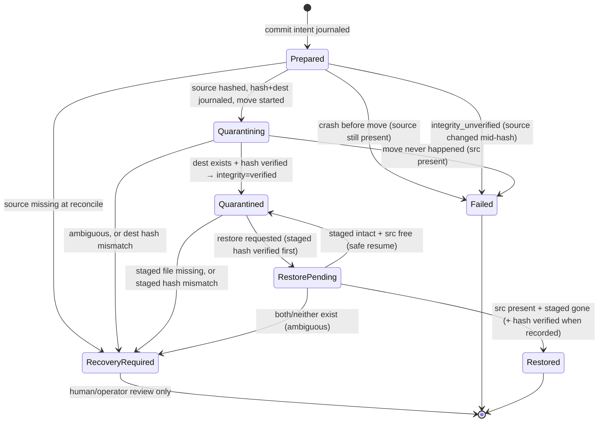

# Quarantine Journal & Crash Recovery (M2, integrity: M8.0.3)

## Journal

`%LOCALAPPDATA%\ClearForge\journal\clearforge.db` — SQLite, WAL + `synchronous=FULL`,
`busy_timeout=5000`. One row per `(session_id, candidate_id)`. Contents: operation id,
candidate id, category, display name, source path, quarantine path, file length,
timestamps, attributes, state, error code, and (schema v2) the expected
`content_sha256` plus an `integrity_state` provenance marker. Never file contents
or secrets.

## Integrity provenance (schema v2)

`integrity_state` records where a digest came from — a hash alone is never
presented as proof:

| value | meaning |
|---|---|
| `captured` | expected hash persisted before the quarantine move |
| `verified` | quarantined artifact content-verified against it |
| `restored` | restored destination content-verified against it |
| `legacy` | schema-v1 row; NO trustworthy historical hash — never backfilled |
| `legacy_restored` | legacy row restored; stored hash was observed at restore time, not proof of original content |
| `failed` | last integrity check failed (paired with a structured `integrity_*` error) |

Migration v1 → v2 is a single transaction (`ALTER TABLE` x2 + row marking +
version bump): interruption rolls it back and the next open retries.
Databases with a newer or malformed `schema_version` fail closed at open.

## State machine

## Quarantine hash lifecycle

1. All existing gates run first: session/approval, containment, reparse-point
   refusal, identity re-check, same-volume, capacity, collision.
2. An *evidence handle* opens the source (`Read` + `Read|Delete` share): while
   held, no new writer can attach, and the rename `File.Move` still works. It
   doubles as the in-use lock check.
3. Source is hashed with streaming I/O; file identity is re-checked after
   hashing — drift ⇒ `integrity_unverified`, nothing moves.
4. One journal write records `Quarantining` + quarantine path + expected hash
   + `integrity=captured`.
5. The move runs while the handle is still open; after it, the destination's
   full content is hashed and compared before `Quarantined`/`verified`.
   Mismatch or read failure ⇒ `RecoveryRequired` + `integrity_*` code; the
   only copy is never deleted.

## Restore integrity gate

Before any restore move the staged artifact is verified against the recorded
expected hash: unreadable ⇒ `integrity_io_error` (row stays Quarantined,
retry-safe); mismatch ⇒ `RecoveryRequired` + `integrity_mismatch`; missing or
malformed hash on a non-legacy row ⇒ `RecoveryRequired` + `integrity_unverified`.
`legacy` rows restore through an explicit unverified path: they succeed, but the
result carries `integrity_legacy_unverified` and the journal records
`legacy_restored` — recoverability is preserved without ever claiming
cryptographic verification.

## Reconcile rules (engine startup, before serving IPC)

| Journal state | Filesystem observation | Resolution |
|---|---|---|
| Prepared | source exists | `Failed(interrupted_before_move)` — safe to retry |
| Prepared | source missing | `RecoveryRequired` — can't prove what happened |
| Quarantining | dest exists w/ matching length, source gone | hash-verified → `Quarantined` + `verified`; mismatch → `RecoveryRequired` |
| Quarantining | source exists, dest absent/mismatched | `Failed(interrupted_during_move)` |
| Quarantining | ambiguous (both present / neither) | `RecoveryRequired` |
| Quarantined | staged file missing | `RecoveryRequired` — never silently clear |
| RestorePending | source present w/ matching length, staged gone | hash-verified → `Restored` + `restored`; mismatch → `RecoveryRequired` |
| RestorePending | staged intact, source free | `Quarantined` (re-offer restore) |
| RestorePending | ambiguous | `RecoveryRequired` |

## Invariants

- Journal row exists **before** any filesystem mutation (`Prepared` first).
- The expected hash and quarantine path are journaled atomically with the
  `Quarantining` transition, before the move.
- Identity check on move-back: staged length + last-write must match journal;
  when a hash exists, full content must match too.
- Restore never overwrites: refuses when anything exists at the source path.
- Same-volume moves only (rename semantics preserve ACLs/metadata);
  cross-volume is refused, never silently copy+deleted.
- A failed verification never deletes or overwrites the only surviving copy.
- Legacy rows are never silently marked verified and never disappear from
  History; their restores are explicitly flagged `integrity_legacy_unverified`.
- No permanent-delete path exists anywhere in the code — verified by test.
